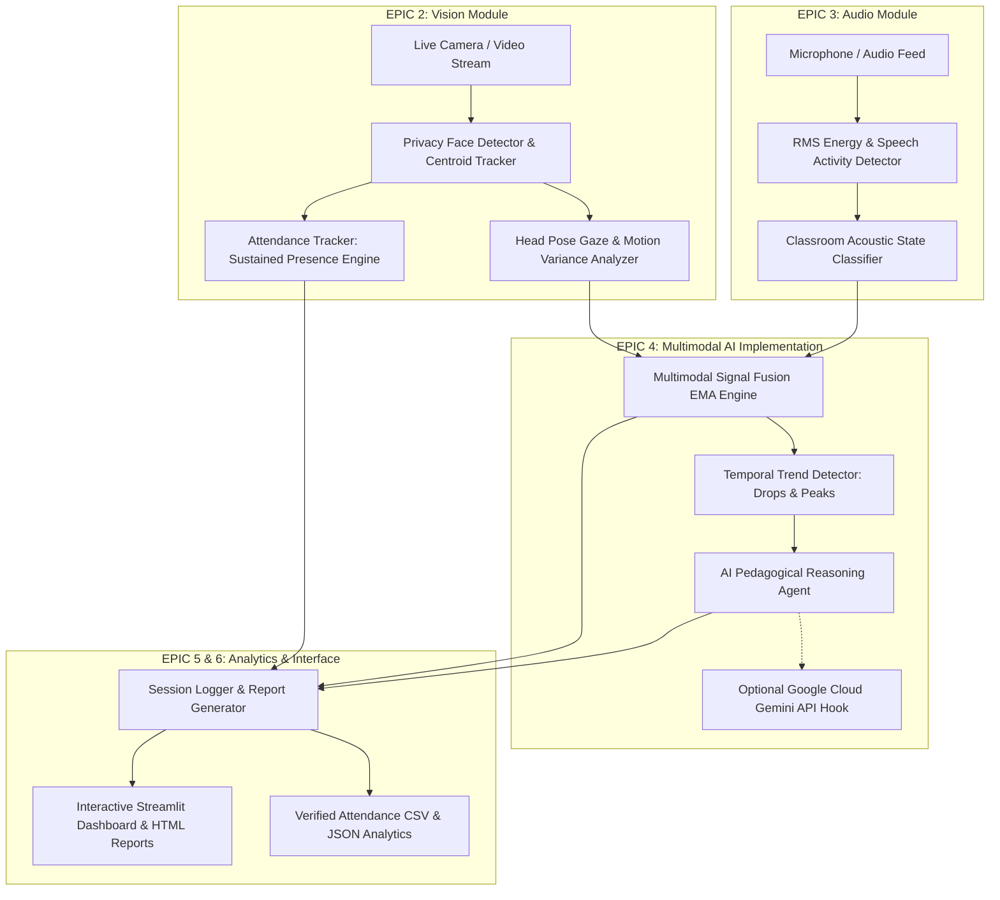

# 🎓 Multimodal Attendance & Engagement Agent

[](https://www.python.org/)
[](https://myskillwallet.ai/)
[]()
[](https://opensource.org/licenses/MIT)

An AI-powered, privacy-preserving classroom intelligence system developed for educational institutions and professional training environments. The project integrates **computer vision**, **audio signal processing**, and **agent-based reasoning** to automatically track attendance based on sustained presence, analyze multimodal engagement trends, generate AI-driven teaching suggestions, and deliver comprehensive student session analytics—all designed to operate entirely offline for ethical and secure deployment.

---

## 📌 Executive Problem Statement & Context
In educational institutions, attendance tracking remains largely manual or limited to basic biometric systems that fail to capture meaningful engagement and participation context. These traditional approaches are time-consuming, prone to inaccuracies, and provide zero insight into learner attention, interaction patterns, or session effectiveness.

As classrooms increasingly adopt digital and hybrid tools, the **Multimodal Attendance & Engagement Agent** moves beyond simple presence detection by fusing visual behavioral indicators with classroom acoustics to provide educators with real-time, non-intrusive pedagogical decision support.

---

## 🌟 Key Scenarios & Capabilities

### 🔍 Scenario 1: Automated Attendance Tracking
- **Sustained Presence Verification:** Processes live or recorded video feeds to detect and track participants. Attendance is marked strictly on **sustained presence** (configurable continuous or cumulative threshold, e.g., $\ge 60\%$ of session duration) rather than instantaneous single-frame detection.
- **Transient Appearance Rejection:** Transient passers-by (e.g., someone walking past the classroom door for 10–20 seconds) are automatically filtered out as `TRANSIENT_IGNORED`, eliminating false positives.
- **Automated Timestamped Logs:** Eliminates manual roll calls by recording First Seen, Last Seen, Total Sustained Duration, and Attendance Timestamp.

### 📊 Scenario 2: Engagement and Session Dynamics Analysis
- **Behavioral Indicators:** Continuously extracts:
  - **Head Pose & Gaze Orientation:** Yaw and pitch deviation angles to distinguish focused gaze from distracted looking away.
  - **Movement Patterns:** Frame displacement variance to detect active participation vs. restlessness vs. drowsiness.
  - **Inactivity Duration:** Flags students exhibiting stillness exceeding 120 seconds.
- **Acoustic Environment Classification:** Evaluates audio energy (RMS) and silence ratios to categorize dynamics into `LECTURE_MONOLOGUE`, `CLASS_DISCUSSION`, `QUIET_STUDY`, or `NOISY_DISTURBANCE`.
- **Multimodal Signal Fusion:** Combines visual and acoustic scores using Exponential Moving Average (EMA) smoothing to detect attention drops, interaction peaks, and session pacing bottlenecks.

### 💡 Scenario 3: AI-Driven Teaching Suggestions
- **Context-Aware Pedagogical Decision Support:** Acts as an assistive tool (never enforcing decisions), generating proactive teaching interventions:
  - **Attention Drops:** Recommends quick concept-check quizzes, live polls, or peer-share prompts when classroom focus dips.
  - **Monologue Pacing Fatigue:** Alerts when instructor lecture exceeds 15 minutes without student interaction.
  - **Interaction Peaks:** Prompts the teacher to summarize and consolidate key student inputs during high-energy discussions.
- **Dual Engine Architecture:** Operates 100% offline using a deterministic expert pedagogical rule system, with an optional cloud hook for **Google Cloud Vertex AI / Gemini 1.5 Flash**.

---

## 🏗️ System Architecture



---

## 📁 Repository Structure

```
multimodal-attendance-agent/
│
├── .gitignore
├── README.md                          # Comprehensive project documentation
├── requirements.txt                   # Production dependencies
├── setup.py                           # Python package setup
├── main.py                            # CLI session orchestrator & simulation runner
├── run_dashboard.bat                  # 1-Click Windows execution script
│
├── configs/
│   └── config.yaml                    # System thresholds, weights, and privacy toggles
│
├── src/
│   ├── __init__.py
│   ├── config.py                      # Strongly-typed configuration loader
│   │
│   ├── vision/                        # EPIC 2: Vision Module Development
│   │   ├── __init__.py
│   │   ├── face_detector.py           # Anonymized face tracking & centroid matching
│   │   ├── attendance_tracker.py      # Sustained presence vs transient filtering logic
│   │   └── engagement_detector.py     # Head pose gaze & motion pattern analytics
│   │
│   ├── audio/                         # EPIC 3: Audio Module Development
│   │   ├── __init__.py
│   │   ├── audio_processor.py         # RMS energy, speech detection & dB level
│   │   └── audio_classifier.py        # Acoustic state classification
│   │
│   ├── ai_agent/                      # EPIC 4: AI Implementation & Reasoning
│   │   ├── __init__.py
│   │   ├── multimodal_fusion.py       # Weighted visual-audio fusion & trend tracking
│   │   ├── reasoning_engine.py        # Context-aware pedagogical suggestion agent
│   │   └── prompt_templates.py        # LLM prompt templates & offline rule catalog
│   │
│   ├── analytics/                     # EPIC 5: Analytics & Recommendation Engine
│   │   ├── __init__.py
│   │   ├── session_logger.py          # CSV & JSON session exporter
│   │   └── report_generator.py        # Markdown and interactive HTML report generator
│   │
│   └── ui/                            # EPIC 6: Interface, Testing, and Deployment
│       ├── __init__.py
│       └── app.py                     # Streamlit interactive classroom dashboard
│
├── tests/                             # Comprehensive automated test suite (100% pass)
│   ├── __init__.py
│   ├── test_attendance.py             # Sustained presence & transient rejection tests
│   ├── test_audio.py                  # Acoustic feature & classification tests
│   ├── test_fusion.py                 # Multimodal weighting & peak detection tests
│   └── test_reasoning_agent.py        # AI suggestion triggers & cooldown guard tests
│
└── sample_data/
    ├── generate_synthetic_data.py     # Classroom simulation dataset generator
    ├── sample_classroom_session.json  # 5-minute benchmark multi-student dataset
    └── sample_classroom.wav           # Sample classroom WAV audio track
```

---

## 🚀 Quick Start Guide

### 1. Prerequisites
- Python 3.9 or higher (tested on Python 3.13)
- Windows / macOS / Linux

### 2. Installation
Clone or navigate to the project directory and install the requirements:
```bash
cd multimodal-attendance-agent
pip install -r requirements.txt
```

### 3. Run Benchmark Simulation (Instant Demo)
Run the automated end-to-end simulation:
```bash
python main.py --mode simulation
```
*This processes a 5-minute benchmark multi-student classroom dataset, validates sustained presence, demonstrates attention drop interventions, and outputs HTML, Markdown, and CSV reports to `session_records/`.*

### 4. Run Automated Test Suite
Verify all unit tests across all 6 Epics:
```bash
python -m unittest discover tests
```

### 5. Launch Interactive Dashboard (Streamlit)
```bash
streamlit run src/ui/app.py
```
Or double-click `run_dashboard.bat` on Windows.

---

## 📊 Sample Simulation Output

```text
===========================================================================
🎓 MULTIMODAL ATTENDANCE & ENGAGEMENT AGENT - SIMULATION MODE
===========================================================================
[*] Configuration Loaded. Sustained Presence Threshold: 180.0s
[*] Offline Mode: True | Anonymization: True

[*] Processing 300 simulation frames...
  [Min 00:00] Active Students: 5 | Engagement: 83.5% | State: LECTURE_MONOLOGUE
  >>> 💡 [AI SUGGESTION - OPTIMAL_FLOW] (LOW Priority)
      🎯 Steady engagement detected across both visual gaze and acoustic feedback.
  [Min 02:00] Active Students: 5 | Engagement: 57.8% | State: QUIET_STUDY
  >>> 💡 [AI SUGGESTION - ATTENTION_DROP] (HIGH Priority)
      💡 Attention dip detected. Try switching the presentation medium (e.g., whiteboard, live code, or short poll).
  [Min 03:00] Active Students: 6 | Engagement: 20.9% | State: QUIET_STUDY
  >>> 💡 [AI SUGGESTION - ATTENTION_DROP] (HIGH Priority)
      🙋 Engagement is tapering off. Ask an open-ended question to a student in the middle rows to re-energize the room.

--- ATTENDANCE LOG (SUSTAINED PRESENCE VERIFICATION) ---
  Student_01                   [PRESENT]                      Present: 4.98m (99.7%)
  Student_02                   [PRESENT]                      Present: 4.98m (99.7%)
  Student_03                   [PRESENT]                      Present: 4.98m (99.7%)
  Student_04                   [PRESENT]                      Present: 4.98m (99.7%)
  Student_05                   [PRESENT]                      Present: 4.98m (99.7%)
  Visitor_Walking_Hallway      [TRANSIENT_IGNORED]            Present: 0.33m (6.7%)
  Late_Courier_Passerby        [TRANSIENT_IGNORED]            Present: 0.25m (5.0%)

[+] Exported Files:
    - Attendance CSV:  session_records/Session_..._attendance.csv
    - HTML Report:     session_records/Session_..._report.html
===========================================================================
✅ Simulation successfully completed.
```

---

## 🔒 Ethical AI & Privacy-Preserving Design
1. **Zero Raw Video Retention:** Raw video frames are discarded immediately after spatial centroid and head pose extraction.
2. **Deterministic Pseudonymization:** Students are assigned local identifiers (e.g., `Student_01_a3f9e1`) derived from cryptographic hashes.
3. **100% Offline Edge Operation:** Computations run on local hardware without sending face embeddings to remote servers.
4. **Assistive Decision Support:** The system never executes autonomous disciplinary actions; recommendations serve purely as helpful pedagogical suggestions for the teacher.

---

## 📤 Submission & GitHub Upload Instructions

### Option A: Using GitHub Desktop (Easiest - 1 Click)
1. Open **GitHub Desktop** on your computer.
2. Click **File** > **Add Local Repository...** (or press `Ctrl + O`).
3. Browse and select the project folder:
   ```
   C:\Users\HP\.gemini\antigravity\scratch\multimodal-attendance-agent
   ```
4. Click **Add Repository**.
5. Click **Publish repository** to GitHub.
6. Copy your repository link (e.g. `https://github.com/your-username/multimodal-attendance-agent`).
7. Paste it into the **Add Github Link** field in SkillWallet and submit!

### Option B: Using Git Command Line
```bash
cd "C:\Users\HP\.gemini\antigravity\scratch\multimodal-attendance-agent"
git init
git add .
git commit -m "feat: complete Multimodal Attendance & Engagement Agent implementation"
git branch -M main
git remote add origin https://github.com/<YOUR_GITHUB_USERNAME>/multimodal-attendance-agent.git
git push -u origin main
```

---

## 📜 License
Distributed under the MIT License. See `LICENSE` for details.
